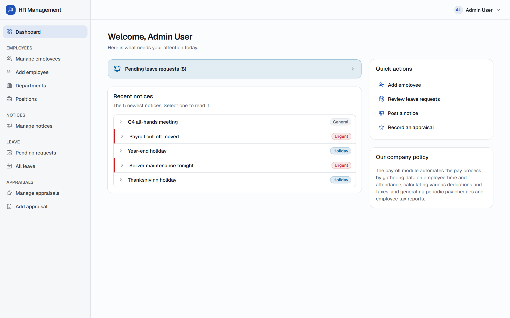
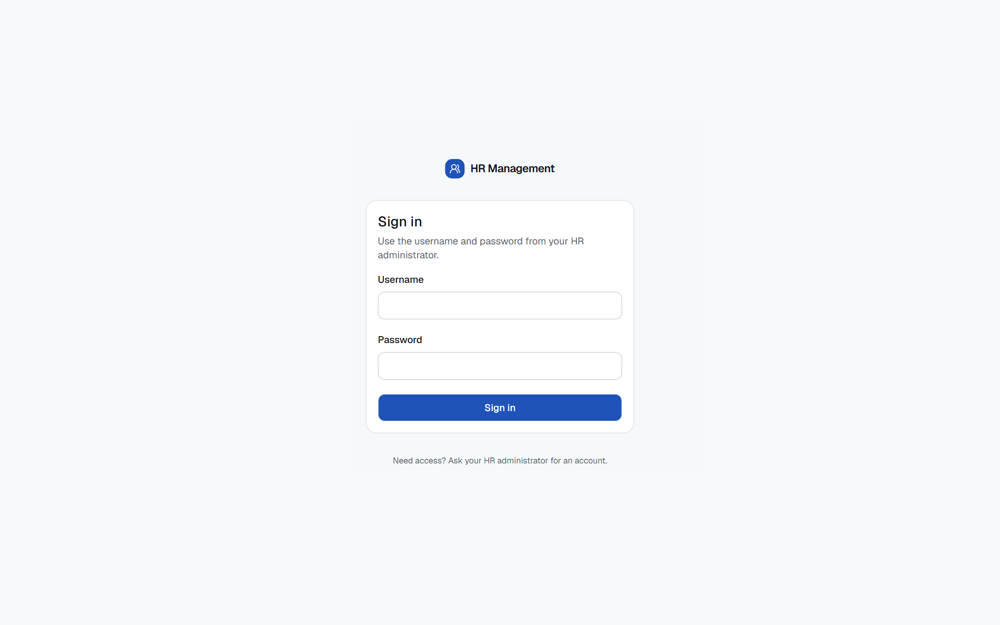
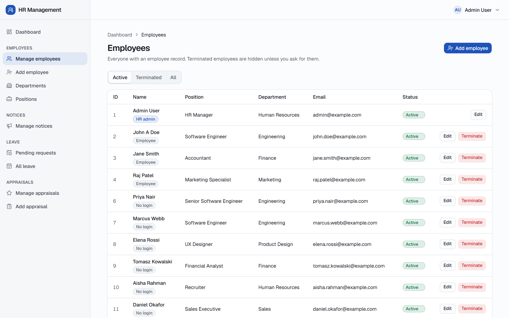
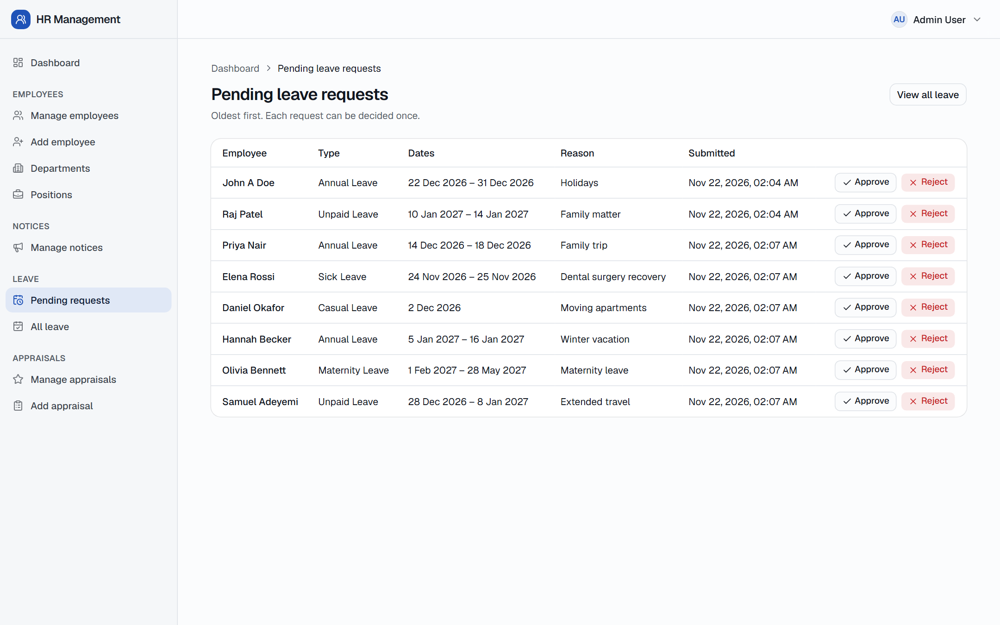
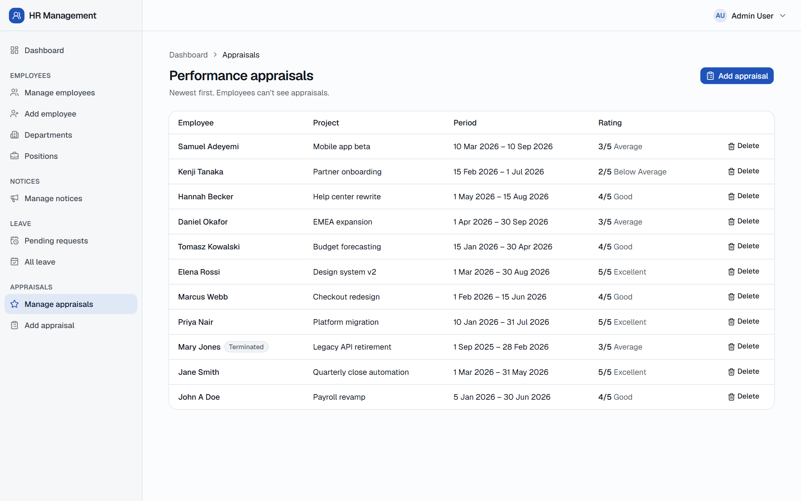
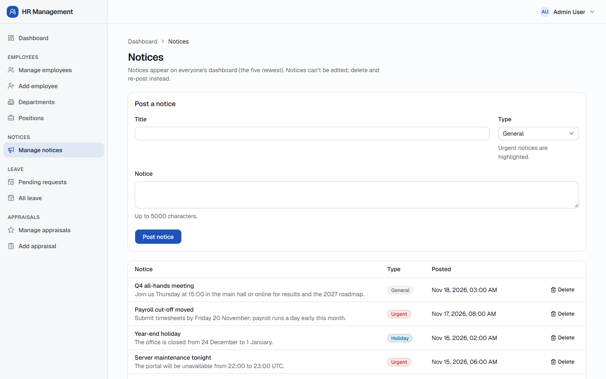
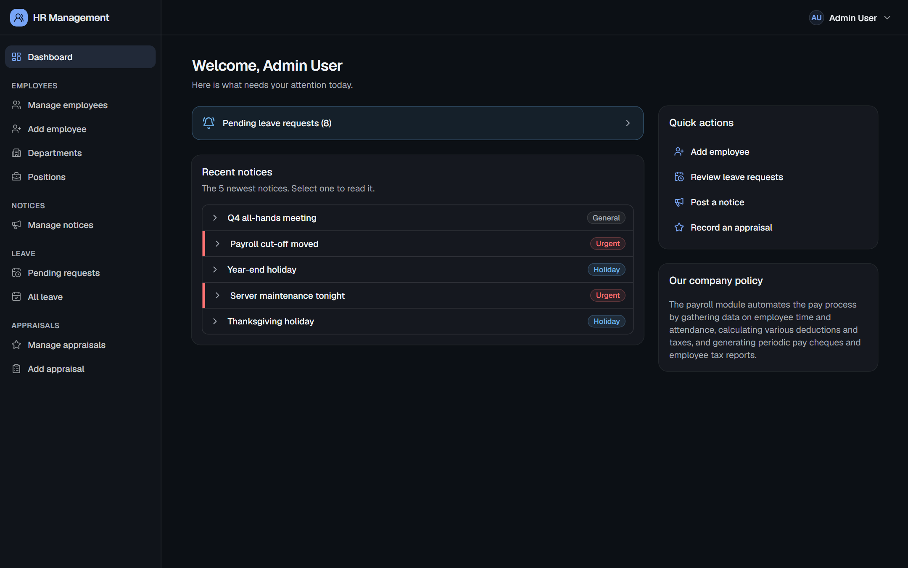

# HR Management System

A web app for managing employees, departments and positions, leave requests,
performance appraisals and company notices. Two roles share one login:
`HR_ADMIN` manages people and records, and `EMPLOYEE` sees their own data and
the notice board. Both can apply for leave.

The app lives in [`web/`](web/). Deployment files (`docker-compose.yml`,
`compose.dev.yml`, `compose.prod.yml`, `docker/`) are at the repo root.



## Stack

Next.js 16 (App Router), React 19, TypeScript, Tailwind CSS 4 and shadcn/ui,
Prisma 7 on PostgreSQL 16, Better Auth with argon2id passwords, Zod 4,
Vitest and Playwright. Full table and conventions: [`web/README.md`](web/README.md).

## Local development

Prerequisites: Node 26 (`nvm use` in `web/`), npm, Docker.

```bash
docker compose -f compose.dev.yml up -d     # Postgres on 127.0.0.1:5432
cd web
npm ci
cp .env.example .env                        # set BETTER_AUTH_SECRET (openssl rand -base64 32)
npm run db:migrate
npm run db:seed                             # dev data (admin / Admin#12345)
npm run dev                                 # http://localhost:3000
```

## Tests

Run from `web/`:

```bash
npm run lint && npm run format:check && npm run typecheck
npm test                                    # unit
npm run test:integration                    # needs DATABASE_URL (a *_test database)
npm run test:e2e                            # Playwright
```

CI (`.github/workflows/ci.yml`) runs all of these plus a build and a Docker
image build. See [`docs/qa/test-strategy.md`](docs/qa/test-strategy.md).

## Create the first admin

A fresh database has no users. With `DATABASE_URL` set:

```bash
cd web
CREATE_ADMIN_PASSWORD='a-strong-password' npm run create-admin -- --username admin
```

The command is idempotent and never prints the password.

## Running in production

Prerequisites: a Docker host with Compose, a domain whose DNS points at it,
and ports 80 and 443 open (Caddy gets the TLS certificate automatically).

1. Create `.env` in the repository root (`cp .env.example .env`) and set:

   | Variable             | Value                                                              |
   | -------------------- | ------------------------------------------------------------------ |
   | `APP_DOMAIN`         | Your hostname, e.g. `hr.example.com` (production only)             |
   | `DB_USER`, `DB_PASS` | Postgres superuser, used only by `db-init`                         |
   | `WEB_DB_USER`        | App database role (default `hr_web_app`)                           |
   | `WEB_DB_PASS`        | App role password, URL-safe: `openssl rand -hex 24`                |
   | `WEB_DB_NAME`        | App database (default `hr_web`)                                    |
   | `BETTER_AUTH_SECRET` | At least 32 characters: `openssl rand -base64 32`                  |
   | `LOG_LEVEL`          | Optional: `fatal`, `error`, `warn`, `info` (default), `debug`, `trace` |

   `BETTER_AUTH_URL` is set to `https://$APP_DOMAIN` by `compose.prod.yml`.
   `DB_PASS` must also be URL-safe.

2. First deploy:

   ```bash
   export COMPOSE_FILE=docker-compose.yml:compose.prod.yml
   docker compose build
   docker compose run --rm db-init
   docker compose run --rm web-migrate
   docker compose run --rm -e CREATE_ADMIN_PASSWORD='a-strong-password' web-migrate \
        node create-admin.mjs --username admin
   docker compose up -d
   curl -fsS https://$APP_DOMAIN/api/health
   ```

   `COMPOSE_FILE` makes every command include `compose.prod.yml`. `create-admin`
   is idempotent and never prints the password.

3. Update to a new version:

   ```bash
   git pull
   docker compose build
   docker compose run --rm web-migrate
   docker compose up -d
   ```

Backups, rollback and the topology are in
[`docs/platform/deployment.md`](docs/platform/deployment.md).

## Screenshots

<table>
  <tr>
    <td width="50%"><br><sub>Sign in</sub></td>
    <td width="50%"><br><sub>Employees</sub></td>
  </tr>
  <tr>
    <td width="50%"><br><sub>Pending leave requests</sub></td>
    <td width="50%"><br><sub>Appraisals</sub></td>
  </tr>
  <tr>
    <td width="50%"><br><sub>Notice board</sub></td>
    <td width="50%"><br><sub>Dashboard in dark mode</sub></td>
  </tr>
</table>

## Documentation

- [`docs/architecture/`](docs/architecture/): ADRs and service contracts
- [`docs/data/`](docs/data/): schema decisions
- [`docs/qa/`](docs/qa/): test strategy
- [`docs/platform/`](docs/platform/): deployment

## License

See [`LICENSE`](LICENSE).
